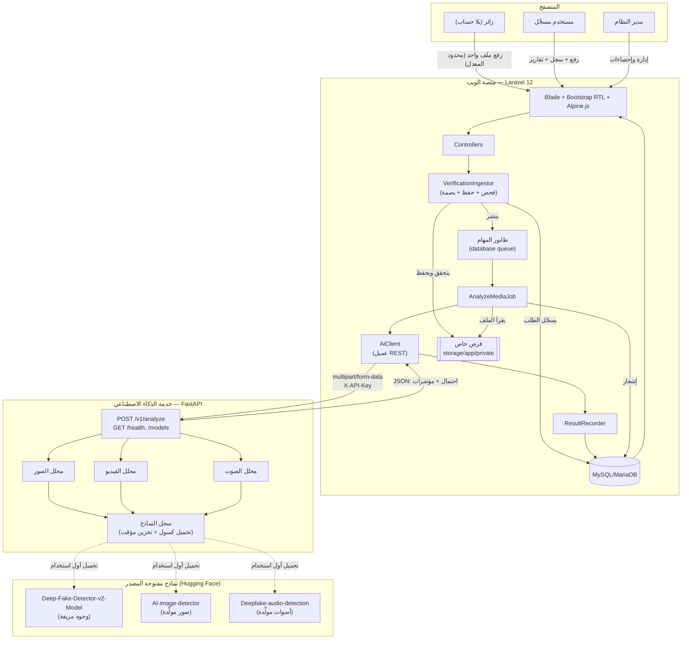

# بنية النظام

## نظرة عامة

## طبقات المنصة

| الطبقة | المسؤولية | أمثلة |
|---|---|---|
| **العرض** | Blade + Bootstrap RTL + Alpine.js، بلا إطار JS ثقيل | `resources/views` |
| **المتحكمات** | تحقق من المدخلات وصلاحيات الوصول (Policies) | `app/Http/Controllers` |
| **الخدمات** | منطق الأعمال المعزول عن HTTP | `app/Services/{Media,Verification,Ai,Report,Evaluation}` |
| **المهام الخلفية** | تحليل الفيديو/الصوت الطويل دون حجب الطلب | `app/Jobs/AnalyzeMediaJob` |
| **النماذج** | Eloquent + علاقات + Enums مطبوعة الأنواع | `app/Models`, `app/Enums` |
| **خدمة الذكاء الاصطناعي** | REST مستقل بلغة Python، لا يشارك قاعدة البيانات | `ai-service/app` |

## لماذا خدمتان منفصلتان؟

- **فصل الاعتماديات الثقيلة**: PyTorch وTransformers وOpenCV لا تُثقل عملية PHP، وتُحدَّث خدمة الذكاء الاصطناعي وتُنشر بشكل مستقل.
- **قابلية التوسع**: يمكن تشغيل عدة نسخ من خدمة FastAPI خلف موازن حمل دون تكرار منطق Laravel.
- **أمان محدد النطاق**: خدمة الذكاء الاصطناعي لا تصل إلى قاعدة البيانات ولا الجلسات؛ تستقبل ملفًا وتُعيد JSON فقط، مصادَقة بمفتاح سري مشترك (`X-API-Key`) تُرفض كل الطلبات بلا مطابقته.

## دورة معالجة الملف (ملخّص)

1. **الاستقبال** (`VerificationIngestor`): فحص الامتداد والحجم ونوع MIME الفعلي (لا اسم الملف)، رفض الملفات التنفيذية، حفظ باسم عشوائي في قرص خاص، حساب SHA-256.
2. **البحث عن نتيجة سابقة**: إن وُجد ملف بالبصمة نفسها حُلِّل من قبل بنموذج ما زال نشطًا، تُعاد نتيجته فورًا دون استدعاء الخدمة.
3. **الطابور**: يُنشر `AnalyzeMediaJob` إلى طابور `analysis`، فلا يحجب طلب HTTP الأصلي.
4. **الاستدعاء**: `AiClient` يرسل الملف عبر REST إلى FastAPI، وأي خطأ شبكي أو رفض من الخدمة يُترجم إلى حالة `failed` برسالة آمنة — لا نتيجة وهمية أبدًا.
5. **التحليل**: FastAPI يختار المحلل المناسب (صورة/فيديو/صوت)، الذي يحمّل النماذج (تحميل كسول عند أول استخدام)، ويعيد احتمال التلاعب والمؤشرات.
6. **الحفظ**: `ResultRecorder` يحسب التصنيف من الحدود الحالية في `system_settings`، ويحفظ النتيجة والمؤشرات وصور الإطارات المشبوهة، ويُخطر المستخدم.
7. **العرض**: صفحة النتيجة، وتقرير PDF (mPDF) عند الطلب، ورابط مشاركة عام اختياري (رمز عشوائي 48 خانة مجزّأ ومشفّر).

## تجربة الزائر بلا حساب

يمكن لزائر غير مسجَّل رفع ملف واحد ورؤية نتيجته من الصفحة الرئيسية مباشرة (بحد 5 ملفات/ساعة لكل عنوان IP). تُنسب هذه الطلبات إلى **حساب نظامي واحد ثابت** (`guest@aimv.internal`، حالته `suspended` فلا يستطيع أحد تسجيل الدخول به)، بينما تُحفظ ملكية النتيجة الفعلية في **جلسة متصفح الزائر** (`session('guest_verification_refs')`) لا في قاعدة البيانات. فحص الوصول يتطلب الشرطين معًا: أن يخص السجل الحساب النظامي، وأن يكون رقمه المرجعي موجودًا في جلسة الطالب نفسها — فلا يستطيع زائر آخر فتح نتيجة غيره حتى لو خمّن رقمها. ملفات الزوار تُحذَف تلقائيًا خلال ساعات (لا أيام)، ولا تُنزَّل لهم تقارير PDF ولا تُتاح لهم المشاركة أو السجل الدائم — تلك حصرًا لأصحاب الحسابات.
