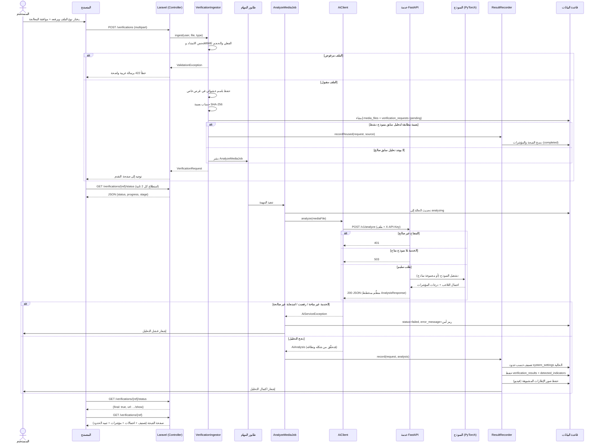

# تسلسل عملية التحقق الكاملة

يغطي هذا المخطط رحلة مستخدم مسجَّل من رفع الملف حتى ظهور النتيجة. تدفّق الزائر بلا حساب مطابق تقريبًا، باستثناء أن المهمة تُعالج فور الرفع (قد تكون متزامنة حسب إعداد الطابور) وتنتهي في صفحة نتيجة محدودة بلا خيار تنزيل.

## نقاط أمان مضمَّنة في التسلسل

- **لا نتيجة بلا تحليل حقيقي**: أي فشل في أي نقطة (شبكة، رفض، استجابة مشوَّهة) ينتهي بحالة `failed` صريحة، لا بدرجة مُخترَعة.
- **إعادة الاستخدام مشروطة بنموذج نشط**: لا تُعاد نتيجة نموذج قديم أُلغي تفعيله من لوحة المدير.
- **الحدود تُقرأ لحظة التصنيف** وتُحفظ مع النتيجة (`thresholds` JSON)، فتغيير المدير للحدود لاحقًا لا يُعيد تصنيف النتائج القديمة بأثر رجعي.
