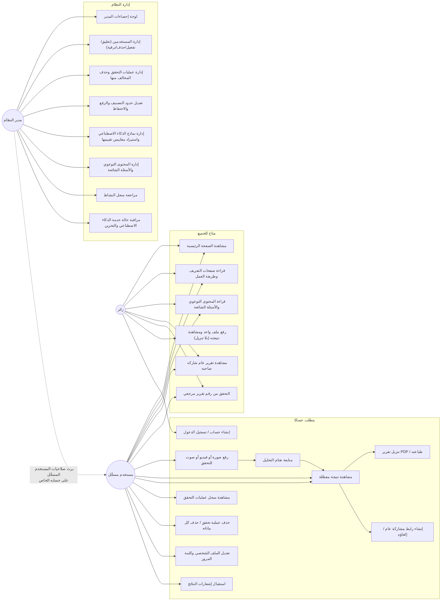

# حالات الاستخدام

## ملاحظات

- **UC6 (رفع الزائر)** مقيَّد بـ 5 ملفات في الساعة لكل عنوان IP، ونتيجته مرتبطة بجلسة متصفحه فقط؛ لا يحصل على تنزيل PDF أو مشاركة أو سجل دائم — تلك تتطلب إنشاء حساب (UC7)، وهي الحافز الأساسي للتسجيل.
- **UC11 (تنزيل PDF) وUC12 (المشاركة)** متاحتان فقط لصاحب عملية التحقق، وتُفرضان عبر Authorization Policy (`VerificationRequestPolicy`) لا عبر الواجهة فقط.
- **UC21 (استيراد مقاييس التقييم)** يرفض أي ملف لا تتطابق أرقامه حسابيًا مع مصفوفة الارتباك المرفقة، فلا يستطيع أحد إدخال نسبة دقة مختلَقة.
- **UC19 (حذف المخالف)** حذف منطقي مع إزالة الملف الفعلي فورًا من القرص، فيبقى أثر تدقيق دون بقاء المحتوى نفسه.
